# SmartOps

SmartOps is an AI-assisted internal service request management system built
with the MERN stack. Employees create and track requests, administrators route
and review work, and staff members process assigned requests and tasks.

> Documentation is based on the implementation currently present in this
> repository. AI assistance is deterministic and rule-based; it is not a
> machine-learning model.

## Contents

- [Overview](#overview)
- [Key features](#key-features)
- [Screenshots](#screenshots)
- [Architecture](#architecture)
- [Roles](#roles)
- [Modules](#modules)
- [AI and notifications](#ai-and-notifications)
- [Data design](#data-design)
- [Project structure](#project-structure)
- [Setup](#setup)
- [API reference](#api-reference)
- [Testing](#testing)
- [Security](#security)
- [Troubleshooting](#troubleshooting)
- [Limitations and future work](#limitations-and-future-work)

## Overview

SmartOps provides a controlled lifecycle:

```text
Pending → Assigned → In Progress → Resolved → Closed
```

The request is stored in MongoDB before dependent notification and email
operations are attempted. MongoDB remains the source of truth. Authenticated
Socket.IO events make connected screens update quickly, while the frontend
reloads authoritative records through REST APIs.

## Key features

- JWT login, bcrypt password hashing, active-account checks, and role guards.
- Public employee registration; staff and admin accounts are administrator
  managed.
- Employee request creation with department, category, priority, location,
  description, and optional attachment.
- Rule-based category, department, priority, and duplicate suggestions.
- Administrator assignment/reassignment and AI Review.
- Staff request processing and task management.
- Status history, comments, resolution evidence, feedback, and audit logs.
- Persistent in-app notifications with authenticated Socket.IO delivery.
- Request confirmation email through Nodemailer when SMTP accepts the message.
- Reports, analytics, user/staff management, departments, and categories.
- Protected attachment/evidence routes with type and size restrictions.

## Screenshots

The following genuine screenshot assets are present in `docs/Screenshots/`:

### Login

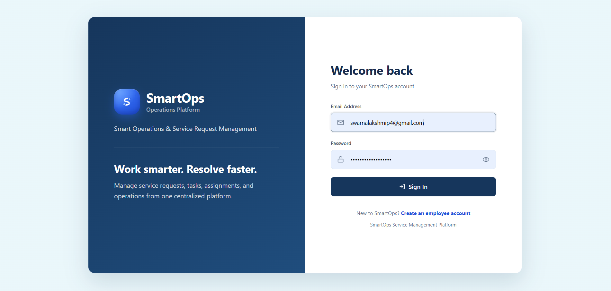

*The public login screen for authenticated SmartOps access.*

### Administrator dashboard

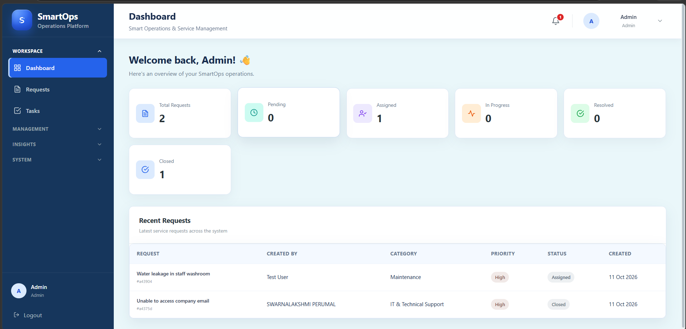

*Request totals and recent operational activity.*

### Employee dashboard

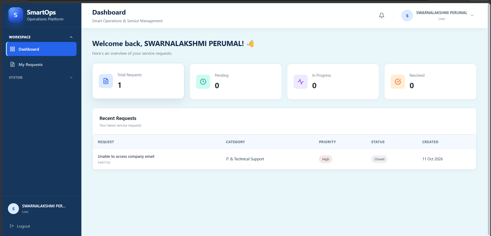

*An employee's request overview.*

### Staff dashboard

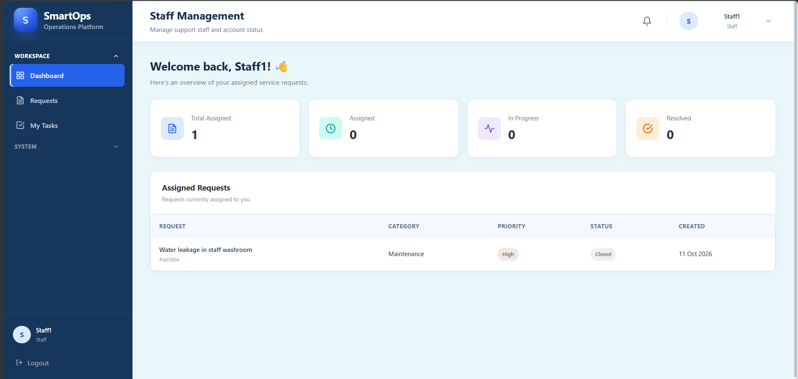

*Assigned staff workload and request status.*

### Request creation

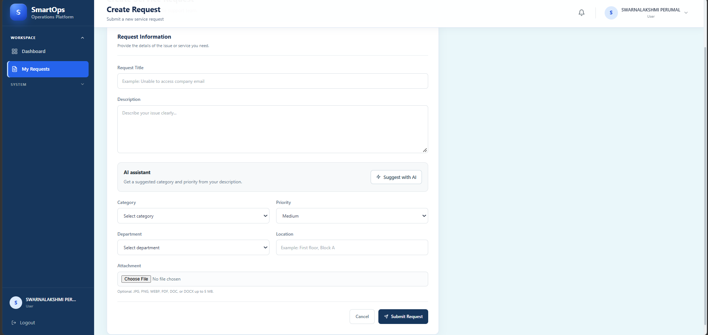

*Request entry and available assistance.*

### Request details

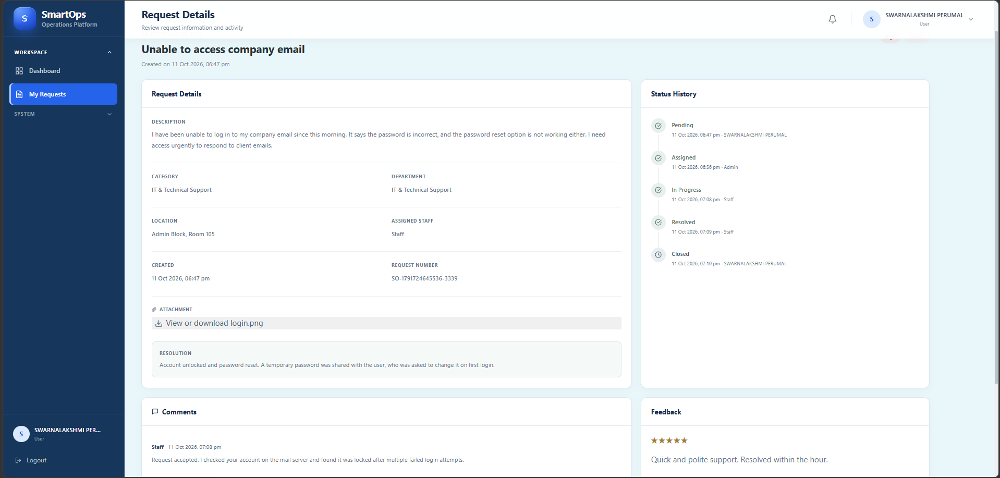

*Request details, history, comments, and available evidence.*

### Notifications

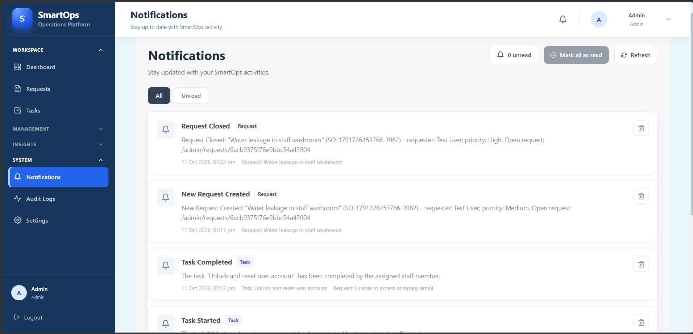

*Persistent notification list and read state.*

### Tasks

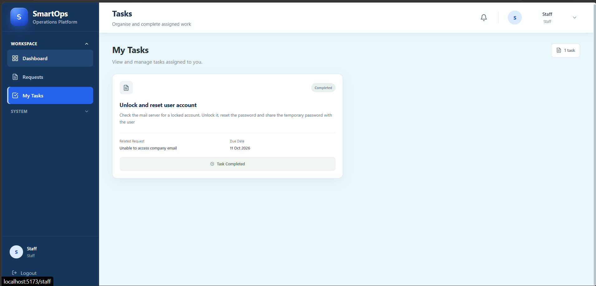

*Task management view.*

### Reports and analytics

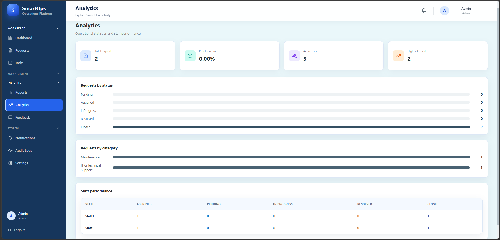

*Administrative reports and analytics.*

### AI review

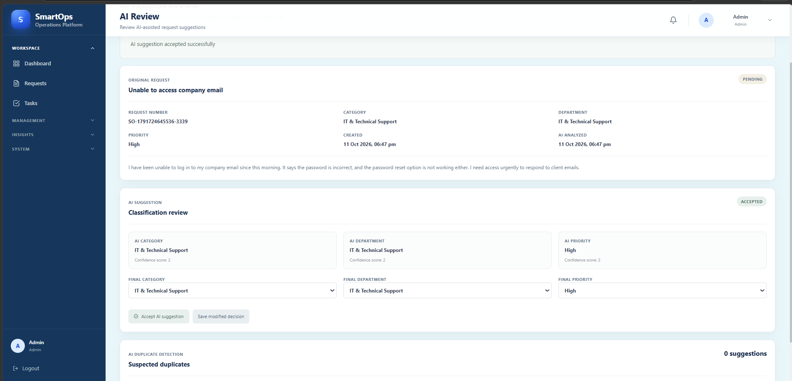

*Administrator review of AI-assisted request information.*

The repository does not currently contain dedicated screenshots for
registration, settings, user management, staff management, departments,
categories, feedback, or audit logs. Capture those from a running application
before adding them; no images should be fabricated for documentation.
See the [screenshot checklist](docs/Screenshots/SCREENSHOT_CHECKLIST.md) for
the pending capture list.

## Architecture

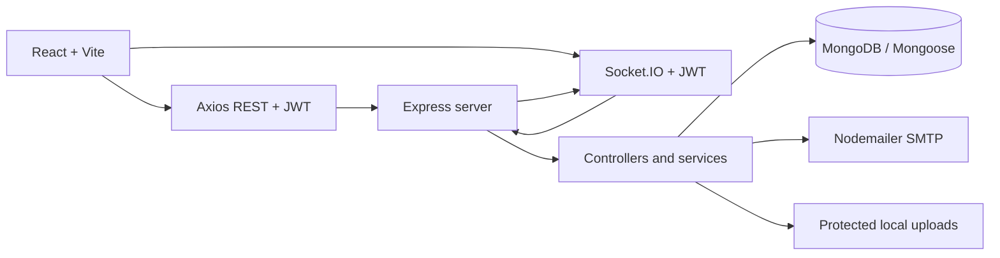

See [docs/ARCHITECTURE.md](docs/ARCHITECTURE.md) for the existing architecture
notes and [docs/PROJECT_DOCUMENTATION.md](docs/PROJECT_DOCUMENTATION.md) for
the complete implementation reference.

## Roles

| Role | Responsibility |
| --- | --- |
| Employee (`user`) | Create, view, comment on, close, and give feedback on personal requests. |
| Staff (`staff`) | View assigned requests, start/resolve work, and process assigned tasks. |
| Administrator (`admin`) | Manage accounts/reference data, view and assign requests, manage tasks, review AI, and inspect insights/audit data. |

Backend middleware and ownership checks enforce these permissions. Frontend
navigation does not replace backend authorization.

## Modules

- **Authentication:** `Backend/src/controllers/authController.js`,
  `Frontend/src/context/AuthContext.jsx`, and auth pages.
- **Requests:** `requestController.js`, `Request.js`, employee/staff/admin
  request pages, and protected file routes.
- **Tasks:** `taskController.js`, `Task.js`, `AdminTasks.jsx`, and
  `StaffTasks.jsx`.
- **Notifications:** `Notification.js`, `notificationService.js`,
  `socketServer.js`, and `Notifications.jsx`.
- **Administration:** user/staff, department, category, feedback, report,
  analytics, audit, and AI Review pages.
- **Shared shell:** `DashboardLayout.jsx`, `Sidebar.jsx`, `Navbar.jsx`, and
  the shared theme styles.

## AI and notifications

AI analysis uses transparent keyword rules to suggest category, department, and
priority. Duplicate detection compares meaningful words in request text. The
administrator can accept or modify classification and confirm or reject a
duplicate suggestion. The system never automatically merges or deletes a
request.

Automatic notifications are saved in MongoDB with idempotency keys. Socket.IO
authenticates each connection with the JWT and uses user/role rooms. Events
include request creation, assignment, lifecycle changes, comments, task
updates, and notification creation. If a user is offline, the MongoDB record
remains available on the next REST refresh.

Request email is attempted only after persistence. SMTP failure leaves the
request saved and must be reported as an email failure rather than a false
success.

## Data design

The main models are:

`User`, `Request`, `Task`, `Notification`, `Feedback`, `Department`,
`Category`, `RequestComment`, and `AuditLog`.

Requests reference their creator and assigned staff, retain status history,
comments, AI fields, attachment metadata, resolution text, and evidence.
Tasks reference a request and assigned staff. Notifications reference users
and optionally requests/tasks. Feedback has a unique request relationship.

## Project structure

```text
SmartOps/
├── Backend/
│   ├── src/server.js
│   └── src/{controllers,models,routes,middleware,services,ai,socket,utils}
├── Frontend/
│   └── src/{components,context,hooks,layouts,pages,routes,services}
├── docs/
│   ├── PROJECT_DOCUMENTATION.md
│   ├── VIVA_PREPARATION.md
│   ├── API_ENDPOINTS.md
│   ├── ARCHITECTURE.md
│   ├── SETUP.md
│   └── Screenshots/
└── README.md
```

## Setup

### Prerequisites

- Node.js 18 or newer
- npm
- MongoDB local instance or MongoDB Atlas
- SMTP credentials only if email is required

### Backend

```powershell
cd D:\IRP_MERN_ICTAK\My_Project\SmartOps\Backend
npm install
npm run dev
```

The backend listens on `http://localhost:5000` by default and exposes the
health response at `GET http://localhost:5000/`.

### Frontend

```powershell
cd D:\IRP_MERN_ICTAK\My_Project\SmartOps\Frontend
npm install
npm run dev
```

Open `http://localhost:5173`.

### Environment variables

Backend variables:

```env
PORT=5000
MONGO_URI=<MongoDB connection string>
JWT_SECRET=<at least 32 characters>
FRONTEND_ORIGIN=http://localhost:5173
MAIL_SERVICE=gmail
MAIL_USER=<sender address>
MAIL_PASSWORD=<SMTP password or app password>
MAIL_FROM=<sender address>
```

Frontend variables:

```env
VITE_API_URL=http://localhost:5000/api
VITE_SOCKET_URL=http://localhost:5000
```

Do not commit `.env` files or credentials. The current working tree does not
contain `.env.example` files; the variable names above match the source and
the setup documentation.

## API reference

The complete route-derived inventory is in
[docs/API_ENDPOINTS.md](docs/API_ENDPOINTS.md). Important endpoint groups are:

- `/auth` — registration and login
- `/users` — users, staff, profiles, and passwords
- `/requests` — request lifecycle, comments, files, assignment, and search
- `/tasks` — task creation and staff task lifecycle
- `/notifications` — persistent notification operations
- `/feedback` — employee feedback and admin review
- `/reports`, `/analytics`, `/audit-logs` — administrator insights
- `/departments`, `/categories` — reference data
- `/ai`, `/ai-review` — analysis and administrator review

Protected calls use:

```http
Authorization: Bearer <JWT_TOKEN>
```

## Testing

The repository currently has no automated test suite. Run the available checks:

```powershell
node --check Backend/src/server.js
cd Frontend
npm run build
```

For manual acceptance, test each role, the complete request lifecycle, task
assignment, notifications in two sessions, SMTP success/failure, protected
attachments, AI Review, reports, feedback, audit logs, and unauthorized
access. Email delivery must be reported only after Nodemailer confirms SMTP
acceptance.

## Security

- Passwords are bcrypt hashes.
- JWTs protect REST and Socket.IO connections.
- Role middleware and ownership checks remain backend enforced.
- Authentication attempts are rate-limited.
- Helmet security headers and controlled CORS are enabled.
- Attachments are restricted by type/size and served through authenticated
  routes.
- Detailed server errors are logged but not exposed in normal API responses.
- Secrets and SMTP credentials must remain outside source control.

## Troubleshooting

- **Port 5000 is busy:** use `netstat -ano | findstr :5000` in Command Prompt,
  then stop the actual listening process or use a different configured port.
- **MongoDB error:** confirm the service/Atlas URI and network access.
- **401/403:** confirm the token, active account, and role.
- **No live notification:** confirm Socket.IO URL, frontend origin, and that
  the recipient is logged in; then verify the MongoDB notification record.
- **Email failure:** verify `MAIL_*` configuration and SMTP acceptance; do not
  treat a successful request save as email delivery.
- **Attachment failure:** check the 5 MB limit, permitted extension, backend
  uploads directory, and authorized request access.
- **Frontend API mismatch:** confirm `VITE_API_URL` includes `/api`.

## Limitations and future work

- Replace local uploads with durable object storage for production scale.
- Add automated frontend/backend tests and authorization regression tests.
- Add structured logging and monitoring.
- Add pagination and stronger reporting scalability.
- Evaluate more advanced AI assistance while retaining administrator review.
- Add the Operational Intelligence scope only if it is formally approved.

## Additional documentation

- [Complete project documentation](docs/PROJECT_DOCUMENTATION.md)
- [Setup guide](docs/SETUP.md)
- [Architecture](docs/ARCHITECTURE.md)
- [Workflows](docs/WORKFLOWS.md)
- [API endpoints](docs/API_ENDPOINTS.md)
