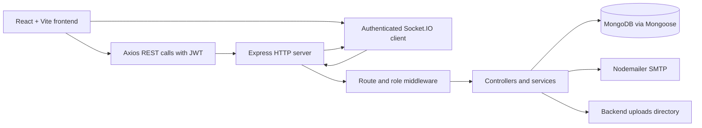
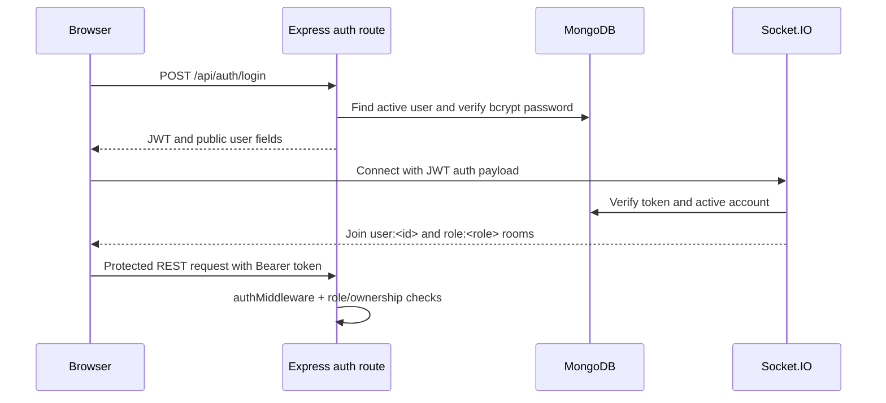
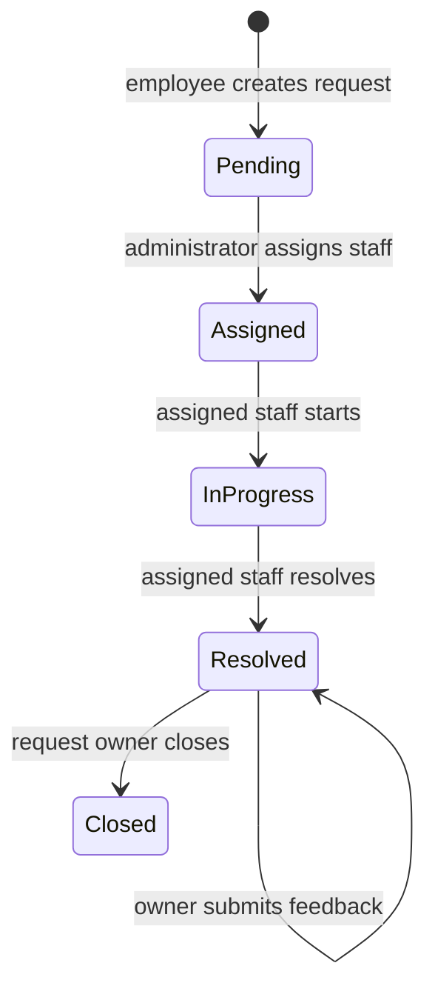
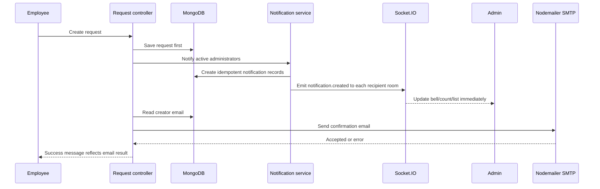

# SmartOps — Project Documentation

## 1. Project title and overview

**SmartOps — AI-Assisted Service Request Management System** is a MERN-stack
web application for submitting, routing, working on, and closing internal
service requests. It provides separate authenticated experiences for
employees (`user`), support staff (`staff`), and administrators (`admin`).

The application combines REST APIs, MongoDB persistence, deterministic
rule-based AI assistance, authenticated Socket.IO updates, email
notifications, role-based access control, file attachments, reporting, and
audit logging.

## 2. Abstract

SmartOps replaces informal request handling with a traceable workflow. An
employee creates a request with a category, department, priority, location,
description, and optional attachment. The system stores the request, offers
AI-assisted suggestions, notifies the appropriate users, and allows an
administrator to assign the work to staff. Staff members update the request
through `In Progress` and `Resolved`, while the request owner completes the
workflow by closing the resolved request and optionally submitting feedback.

MongoDB is the persistent source of truth. Socket.IO provides immediate
authenticated updates, while the frontend uses REST calls to reload the
authoritative data. The AI features are transparent keyword and word-overlap
rules, not a machine-learning model.

## 3. Problem statement

Internal service requests are difficult to manage when they are scattered
across informal messages or email. Employees may not know the current status,
administrators may not have a complete workload view, and staff assignment,
history, evidence, and feedback can be lost. SmartOps provides one controlled
place to capture the request, track ownership and status, communicate through
comments, and retain operational history.

## 4. Motivation and purpose

The project is intended to improve visibility and accountability in an
organization's support process. Its purpose is to:

- give employees a simple request submission and tracking experience;
- help administrators route and monitor work;
- give staff a focused list of assigned requests and tasks;
- reduce repetitive classification using explainable AI suggestions;
- preserve comments, status history, evidence, notifications, and audit data;
- provide reports and analytics for operational review.

## 5. Objectives

1. Implement secure JWT authentication and role-based access control.
2. Provide a complete request lifecycle from `Pending` to `Closed`.
3. Support staff assignment, reassignment, tasks, comments, attachments, and
   resolution evidence.
4. Persist notifications in MongoDB and deliver them immediately through
   authenticated Socket.IO connections.
5. Send a request-confirmation email after successful MongoDB persistence when
   SMTP is configured.
6. Provide explainable category, department, priority, and duplicate-request
   assistance.
7. Give administrators management, reporting, analytics, feedback, AI-review,
   and audit-log views.

## 6. Scope

### In scope

- public employee registration;
- login, logout, profile update, and password change;
- administrator-managed staff, users, departments, and categories;
- employee request creation and tracking;
- request assignment and reassignment by administrators;
- staff request and task processing;
- request comments, attachments, resolution evidence, and feedback;
- persistent in-app notifications and Socket.IO updates;
- request email confirmation through Nodemailer;
- deterministic AI suggestions and administrator review;
- reports, analytics, and audit logs.

### Explicitly outside the final implementation

- machine-learning model training or inference;
- automatic assignment or workload redistribution;
- automatic request merging or deletion after duplicate detection;
- public staff or administrator registration;
- the old unmounted `/api/test` routes;
- the planned Operational Intelligence dashboard.

## 7. Existing system and limitations

The original manual approach would require employees and support personnel to
coordinate through separate messages or email. That approach has limited
status visibility, weak ownership tracking, and no unified audit trail.

The implemented system improves those limitations, but it still has known
operational constraints:

- uploaded files are stored on the backend filesystem under `Backend/uploads`;
- production deployments with ephemeral disks or multiple instances need
  durable mounted storage or object storage;
- email delivery depends on valid SMTP configuration and is not guaranteed by
  a successful application build;
- AI suggestions are rule-based and should be reviewed by an administrator;
- the server currently writes operational logs to the process console;
- no automated test suite is present in the repository; available checks are
  syntax, build, and manual/runtime checks.

## 8. Proposed system and advantages

SmartOps uses a React/Vite client and an Express/Mongoose server connected to
MongoDB. REST APIs perform authenticated reads and writes. Socket.IO sends
scoped events to authenticated users and role rooms. This design provides:

- one persistent source of truth;
- clear separation between presentation, API, domain controllers, models, and
  services;
- role-scoped access decisions in the backend;
- immediate interface refreshes without treating a socket event as storage;
- explainable AI output rather than opaque or automatic decisions;
- retained history for troubleshooting and reporting.

## 9. Functional requirements implemented

| Area | Implemented behavior |
| --- | --- |
| Authentication | Register employees, log in, issue JWTs, expire sessions, log out. |
| Users | Admin lists, updates, activates/deactivates, and safely manages users. |
| Staff | Admin creates and manages staff accounts and department information. |
| Reference data | Admin creates, edits, activates/deactivates, and removes departments/categories subject to historical safeguards. |
| Requests | Users create and edit their own requests; admins view all; staff view assigned work. |
| Lifecycle | `Pending → Assigned → In Progress → Resolved → Closed`. |
| Tasks | Admin creates/assigns tasks; staff starts and completes assigned tasks. |
| Collaboration | Authorized users add and view request comments. |
| Files | Users upload permitted request files; authorized users download attachments/evidence through protected routes. |
| Notifications | Persistent user notifications, unread state, links, Socket.IO delivery, read/delete controls. |
| Email | Confirmation email is attempted after request persistence using the creator email from MongoDB. |
| AI | Rule-based analysis, duplicate suggestions, and administrator review. |
| Insights | Reports, analytics, feedback, and administrator audit logs. |

## 10. Non-functional requirements and controls

- **Security:** JWT authentication, active-account checks, role middleware,
  ownership checks, protected file routes, Helmet, CORS, and authentication
  rate limiting.
- **Integrity:** Mongoose schemas validate enums, required fields, unique
  values, and request lifecycle data.
- **Availability:** REST remains authoritative even when a socket is not
  connected; frontend refresh hooks reload data after relevant events.
- **Usability:** Role-specific navigation, responsive layouts, loading/error/
  empty states, accessible labels, focus states, and confirmation messages.
- **Traceability:** Request status history, notification records, and audit
  records preserve operational context.
- **Maintainability:** Routes, controllers, models, services, middleware, and
  frontend pages are separated by responsibility.

## 11. Technology stack

| Technology | Purpose in SmartOps |
| --- | --- |
| React 19 | Component-based frontend UI. |
| Vite | Frontend development server and production bundler. |
| React Router | Public, protected, and role-based routes. |
| Axios | Authenticated REST API client. |
| React Icons | UI icons. |
| Node.js | Backend runtime. |
| Express 5 | HTTP server and REST routing. |
| MongoDB | Persistent document database. |
| Mongoose | MongoDB schemas, validation, and queries. |
| JWT | Stateless authentication token. |
| bcryptjs | Password hashing and verification. |
| Socket.IO | Authenticated real-time events. |
| Nodemailer | SMTP email delivery. |
| Multer | Multipart upload handling and file restrictions. |
| Helmet | HTTP security headers. |
| CORS | Controlled frontend/backend origin access. |
| express-rate-limit | Login and registration rate limiting. |

## 12. System architecture



The backend creates one HTTP server and initializes Express and Socket.IO on
it. `server.js` mounts the active route modules under `/api`. The frontend
stores the JWT in the existing authentication context and sends it in Axios
headers and the Socket.IO authentication payload.

## 13. Frontend architecture

```text
Frontend/src/
├── App.jsx                         public and role-based route tree
├── main.jsx                        React entry point
├── context/AuthContext.jsx         login state, token, logout, expiry handling
├── services/api.js                 Axios base URL and auth header handling
├── services/socket.js              Socket.IO client wrapper
├── routes/ProtectedRoute.jsx       role guard
├── layouts/DashboardLayout.jsx    shared sidebar/navbar shell
├── components/
│   ├── navbar/                    page title, profile, notifications
│   └── sidebar/                   grouped role-aware navigation
├── hooks/useRealtimeRefresh.js     event-driven REST refresh helper
└── pages/
    ├── auth/                      Login and Register
    ├── user/                      employee dashboard and request pages
    ├── staff/                     staff dashboard, requests, and tasks
    ├── admin/                     admin operations and insights
    ├── shared/Settings.jsx        profile and password settings
    └── Notifications.jsx          shared notification list
```

`App.jsx` uses `DashboardLayout` for authenticated routes. The sidebar derives
its links from the authenticated role, and `ProtectedRoute` enforces the same
role boundary at the frontend. Backend middleware remains the security source
of truth.

## 14. Backend architecture

```text
Backend/src/
├── server.js
├── config/db.js
├── models/                         Mongoose schemas
├── routes/                         Express route declarations
├── controllers/                    request handlers and validation
├── middleware/                     JWT, role, and upload middleware
├── services/                       email and notification services
├── socket/socketServer.js          JWT socket auth, rooms, event emission
├── ai/aiRules.js, aiService.js     deterministic AI logic
└── utils/auditLogger.js            audit record helper
```

Controllers validate input and authorization, perform model operations, call
services, and emit events. Route files define which roles may invoke each
controller.

## 15. Database design

The active Mongoose models map to the following logical collections:

| Model/collection | Important fields and relationships |
| --- | --- |
| `User` / `users` | `name`, `email`, `phone`, `department`, hashed `password`, `role`, `isActive`, timestamps. |
| `Request` / `requests` | Request number, title, description, category, department, priority, status, creator, assignee, history, comments, AI fields, attachment metadata, resolution/evidence. |
| `Task` / `tasks` | Title, description, linked `requestId`, `assignedTo`, status, due date, completion date. |
| `Notification` / `notifications` | Recipient, title, message, type, related request/task, link, idempotency key, read state. |
| `Feedback` / `feedback` | Unique request, user, rating, comment, timestamps. |
| `Department` / `departments` | Unique name, description, active state, timestamps. |
| `Category` / `categories` | Unique name, description, active state, timestamps. |
| `RequestComment` | Request, author, comment text, timestamps; the current request controller also maintains embedded request comments. |
| `AuditLog` / `auditlogs` | User, action, module, description, optional request, timestamps. |

The `Request` schema stores `createdBy` and `assignedTo` as User references,
and `Task` stores both a request reference and staff assignment. Departments
and categories are currently stored as names in requests/users while the
administrator reference records are maintained separately.

## 16. Roles and permissions

| Capability | Employee (`user`) | Staff (`staff`) | Administrator (`admin`) |
| --- | :---: | :---: | :---: |
| Register publicly | Yes | No | No |
| Create own request | Yes | No | No |
| View own requests | Yes | No | No |
| View assigned requests | No | Yes | All |
| Assign/reassign requests | No | No | Yes |
| Start/resolve request | No | Assigned only | No lifecycle action through staff endpoint |
| Close resolved request | Own request | No | No |
| Create tasks | No | No | Yes |
| Work assigned tasks | No | Yes | View all |
| Manage users/staff/reference data | No | No | Yes |
| Review AI suggestions | No | No | Yes |
| View reports/analytics/audit logs | No | No | Yes |
| Comment on authorized request | Yes | Yes | Yes |
| Download authorized files | Creator | Assigned staff | Yes |

The backend applies `authMiddleware` and `roleMiddleware`; frontend hiding is
not relied on for authorization.

## 17. Authentication and authorization flow



Tokens are signed with `JWT_SECRET` and expire after one hour in the login
controller. The frontend stores the token and user in local storage through
`AuthContext`. The Axios client reacts to expired authentication, while the
socket middleware rejects missing, invalid, expired, or inactive accounts.

## 18. Request lifecycle



1. The employee submits request data and an optional multipart attachment.
2. The backend validates and saves the request first, generating a request
   number and storing status history.
3. Active administrators receive a persistent notification and Socket.IO
   event. The request creator receives a confirmation email when SMTP accepts
   it; an email failure does not roll back the request.
4. The administrator assigns or reassigns staff. The assigned staff member
   receives the assignment notification.
5. Staff starts and resolves the request, optionally adding resolution
   evidence. The request owner receives status notifications.
6. The owner closes a resolved request and may submit one feedback record.

Relevant files are `requestController.js`, `Request.js`,
`notificationService.js`, `emailService.js`, `socketServer.js`,
`CreateRequest.jsx`, `RequestDetails.jsx`, and the role-specific request pages.

## 19. Task workflow

Tasks are administrator-created work items linked to a request and assigned to
staff. A task has `Pending`, `In Progress`, and `Completed` states.

```text
Admin creates task and assigns staff
        ↓
Staff views /tasks/my
        ↓
Staff starts task
        ↓
Staff completes task
```

Task operations are handled by `taskController.js` and `taskRoutes.js`.
Task notifications and Socket.IO events are emitted for assigned staff and
administrators. A task is related to a request but is not the same thing as a
request lifecycle status.

## 20. Comments, evidence, feedback, and attachments

- **Comments:** authorized users post and read request comments. Events cause
  request detail pages to refresh.
- **Attachments:** Multer accepts JPG, JPEG, PNG, WEBP, PDF, DOC, and DOCX up
  to 5 MB. The stored filename and original metadata are persisted on the
  request. The authenticated download controller checks request ownership,
  assignment, or administrator role before reading from `Backend/uploads`.
- **Resolution evidence:** staff may submit resolution text and optional
  evidence. The same protected file access rules apply.
- **Feedback:** after the user closes a resolved request, the user can submit
  one rating from 1 to 5 and an optional comment. The unique request relation
  prevents duplicate feedback records.

## 21. Notifications and email



Automatic notification keys such as request/event/recipient combinations make
retries idempotent. Notifications remain in MongoDB even if the recipient is
offline. The frontend receives `notification.created` and reloads unread/list
data through REST. Other lifecycle events include request assignment, start,
resolution, closure, comments, task assignment, task updates, and AI review
work where implemented.

## 22. AI modules

The AI is implemented in `Backend/src/ai/aiRules.js` and
`Backend/src/ai/aiService.js` as deterministic assistance:

| Feature | Input | Output | Decision owner |
| --- | --- | --- | --- |
| Category suggestion | Request title/description | Suggested category and score | Employee/admin review |
| Department suggestion | Request text | Suggested department and score | Employee/admin review |
| Priority prediction | Request text | Low/Medium/High/Critical suggestion and score | Employee/admin review |
| Duplicate detection | New request and existing request text | Similar request candidates and similarity | Administrator |

Users can request analysis during creation. Stored AI data is hidden from
normal request responses where appropriate. Administrators use AI Review to
accept or modify classification and confirm/reject duplicate suggestions.
The system does not automatically merge, delete, assign, close, or override
requests.

## 23. Administrator AI review

The admin request page links to AI Review when analysis or duplicate data is
available. `aiReviewController.js` loads review data and applies administrator
decisions. A duplicate decision is stored as `pending`, `confirmed`, or
`rejected` with reviewer and timestamp data. Confirming a duplicate does not
delete or merge either request.

## 24. Reports, analytics, feedback, and audit logs

- **Reports:** request summary, category summary, staff workload, and date
  filtered request reports are provided by `reportController.js`.
- **Analytics:** dashboard totals, category counts, and staff performance are
  provided by `analyticsController.js` and displayed on the admin Analytics
  page.
- **Feedback:** admins can review all feedback and feedback for a request;
  users manage their own feedback.
- **Audit logs:** administrator actions in management flows are recorded by
  `auditLogger.js` and viewed through `/admin/audit-logs`.

## 25. API endpoint documentation

The complete route-derived endpoint inventory is maintained in
[API_ENDPOINTS.md](./API_ENDPOINTS.md). The active base URL is
`http://localhost:5000/api` during development.

Main endpoint groups are:

| Group | Active route module | Main operations |
| --- | --- | --- |
| Authentication | `authRoutes.js` | Register and login. |
| Users | `userRoutes.js` | User/staff management and self-service profile/password. |
| Requests | `requestRoutes.js` | Create, read, search, assign, lifecycle, comments, files. |
| Tasks | `taskRoutes.js` | Create, list, start, complete. |
| Notifications | `notificationRoutes.js` | Create, list, unread, read, delete. |
| Feedback | `feedbackRoutes.js` | Create, list, update, delete. |
| Reports | `reportRoutes.js` | Summary, categories, workload, date reports. |
| Analytics | `analyticsRoutes.js` | Dashboard, category, staff performance. |
| AI | `aiRoutes.js`, `aiReviewRoutes.js` | Analyze, duplicate detection, review. |
| Reference data | `departmentRoutes.js`, `categoryRoutes.js` | Admin CRUD/status and active lookups. |
| Audit | `auditLogRoutes.js` | Admin audit listing. |

## 26. Important source files

### Backend

- `Backend/src/server.js` — server, security middleware, route mounting.
- `Backend/src/controllers/requestController.js` — request lifecycle,
  attachments, comments, notifications, email integration.
- `Backend/src/controllers/taskController.js` — task lifecycle.
- `Backend/src/controllers/authController.js` — registration/login/JWT.
- `Backend/src/services/notificationService.js` — persistent automatic
  notifications and duplicate prevention.
- `Backend/src/services/emailService.js` — Nodemailer transport and sanitized
  email result/error handling.
- `Backend/src/socket/socketServer.js` — JWT socket authentication, rooms,
  and event emission.
- `Backend/src/middleware/authMiddleware.js` and `roleMiddleware.js` — access
  control.
- `Backend/src/middleware/uploadMiddleware.js` — type and size restrictions.
- `Backend/src/utils/auditLogger.js` — audit persistence helper.

### Frontend

- `Frontend/src/App.jsx` — route tree.
- `Frontend/src/context/AuthContext.jsx` — authenticated state.
- `Frontend/src/layouts/DashboardLayout.jsx` — shared shell.
- `Frontend/src/components/sidebar/Sidebar.jsx` — role navigation.
- `Frontend/src/components/navbar/Navbar.jsx` — title, profile, notification
  badge.
- `Frontend/src/pages/user/CreateRequest.jsx` — request creation and AI
  assistance.
- `Frontend/src/pages/user/RequestDetails.jsx` — details, comments, files,
  lifecycle close, and feedback.
- `Frontend/src/pages/admin/AdminAIReview.jsx` — administrator AI review.
- `Frontend/src/pages/Notifications.jsx` — notification list/read/delete UI.

## 27. Installation and environment setup

Prerequisites are Node.js 18+, npm, MongoDB local or Atlas, and SMTP
credentials if email is required. Follow [SETUP.md](./SETUP.md) for the
PowerShell commands.

Required backend configuration uses environment variables only:

```env
PORT=5000
MONGO_URI=<MongoDB connection string>
JWT_SECRET=<at least 32 characters>
FRONTEND_ORIGIN=http://localhost:5173
MAIL_SERVICE=gmail
MAIL_USER=<sender address>
MAIL_PASSWORD=<SMTP password or app password>
MAIL_FROM=<sender address>
```

Frontend production configuration uses:

```env
VITE_API_URL=http://localhost:5000/api
VITE_SOCKET_URL=http://localhost:5000
```

Never commit real values. In this repository the `.env.example` files are not
present in the current working tree, so use the variable names documented in
`docs/SETUP.md` and keep local `.env` files private.

## 28. Running the application

```powershell
cd D:\IRP_MERN_ICTAK\My_Project\SmartOps\Backend
npm install
npm run dev
```

In a second terminal:

```powershell
cd D:\IRP_MERN_ICTAK\My_Project\SmartOps\Frontend
npm install
npm run dev
```

Open `http://localhost:5173`. The backend health endpoint is
`http://localhost:5000/`.

## 29. Testing and verification strategy

The repository currently has no automated test suite. Available checks are:

```powershell
node --check Backend/src/server.js
cd Frontend
npm run build
```

Manual acceptance checks should cover each role's login, request lifecycle,
task lifecycle, notifications, attachments, AI review, reports, feedback,
audit logs, and unauthorized route/file access. Email testing requires a real
test recipient and a confirmed SMTP response; a build is not proof of email
delivery. `Backend/testEmail.js` is an available SMTP smoke-test utility.

## 30. Error handling, validation, and security

- Authentication errors are handled with 401 responses and expired-session
  cleanup.
- Role and ownership failures return 403 responses.
- Invalid identifiers, inputs, transitions, and uploads return safe client
  messages.
- The backend removes detailed `error` fields from JSON responses while
  retaining server-side logging.
- Request upload middleware rejects unsupported types, empty files, and files
  larger than 5 MB.
- Protected download routes validate the stored filename and request access.
- Passwords are bcrypt hashes; password fields are not returned in user data.
- Login and registration are rate-limited.
- JWT and Socket.IO connections require the configured secret and active user.
- Helmet and controlled CORS are enabled.

## 31. Known limitations and future enhancements

- Move uploads to durable object storage for production scale.
- Add automated backend and frontend tests, including authorization tests.
- Add observability, structured logging, and deployment health checks.
- Replace or augment rule-based AI with evaluated ML/LLM assistance only with
  clear review and privacy controls.
- Add operational intelligence modules if they become part of scope.
- Add pagination for very large notification/request/report datasets.
- Add stronger retry/outbox handling for email and notification workflows.

## 32. Conclusion

SmartOps implements an end-to-end internal request management workflow with
role-aware screens, persistent MongoDB data, explainable AI assistance,
real-time delivery, protected files, email confirmation, reporting, and audit
visibility. The source files and endpoint inventory linked above are the
authoritative references for the implemented behavior.

## References

- [Setup guide](./SETUP.md)
- [Architecture notes](./ARCHITECTURE.md)
- [Workflow summary](./WORKFLOWS.md)
- [API endpoint inventory](./API_ENDPOINTS.md)
- [Software Requirements Specification](./SRS_SmartOps.pdf)
- [Backend source](../Backend/src/)
- [Frontend source](../Frontend/src/)
